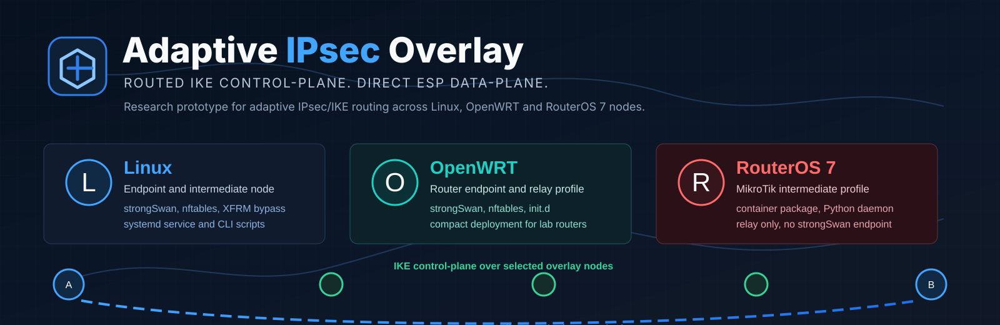

# Vladislav Zyuzin

**AI Full-Stack & Systems Engineer** — production AI workflows, reliable backend/frontend systems, Linux/network infrastructure, and adaptive VPN research.

## Core Engineering & Open Templates

| Repository | Focus | Stack |
| --- | --- | --- |
| [ai-workflow-backend](https://github.com/ZuyVladislav/ai-workflow-backend) | Production template for structured LLM workflows, PII masking, idempotent jobs, and CI | Python, FastAPI, Pydantic, PostgreSQL, Docker |
| [ha-infra-blueprint](https://github.com/ZuyVladislav/ha-infra-blueprint) | Zero-downtime atomic symlink releases with rollback trap, WireGuard mesh audit, Nginx TLS, and PG backups | Bash, Python, Nginx, WireGuard, PostgreSQL |
| [antigravity-ru-localizer](https://github.com/ZuyVladislav/antigravity-ru-localizer) | Local static UI localizer and compatibility patcher for Google Antigravity | JavaScript, Node.js, Cross-platform CI |

Selected commercial products (full-stack web/mobile systems, document AI pipelines such as **Doc Autopilot**, infrastructure AI diagnostics, and US healthcare clinic engineering) are showcased at [vladislav-it.com](https://vladislav-it.com).

---

## Adaptive IPsec & Overlay Networking Lab

I build and test routed IKE control-plane schemes where negotiation can traverse selected intermediate nodes while ESP remains direct between endpoints after security associations are established.

### Featured Network Repositories

| Repository | Scope |
| --- | --- |
| [Adaptive-Secure-Overlay/adaptive-ipsec-overlay](https://github.com/Adaptive-Secure-Overlay/adaptive-ipsec-overlay) | Project hub, architecture, and cross-platform documentation |
| [Adaptive-Secure-Overlay/adaptive-ipsec-overlay-linux](https://github.com/Adaptive-Secure-Overlay/adaptive-ipsec-overlay-linux) | Linux endpoint and intermediate-node package |
| [Adaptive-Secure-Overlay/adaptive-ipsec-overlay-openwrt](https://github.com/Adaptive-Secure-Overlay/adaptive-ipsec-overlay-openwrt) | OpenWRT endpoint and intermediate-node package |
| [Adaptive-Secure-Overlay/adaptive-ipsec-overlay-routeros7](https://github.com/Adaptive-Secure-Overlay/adaptive-ipsec-overlay-routeros7) | MikroTik RouterOS 7 container profile for intermediate nodes |
| [Adaptive-Secure-Overlay/adaptive-ipsec-overlay-android](https://github.com/Adaptive-Secure-Overlay/adaptive-ipsec-overlay-android) | Kotlin Android client prototype for mobile endpoint integration |
| [Adaptive-Secure-Overlay/adaptive-ipsec-overlay-windows](https://github.com/Adaptive-Secure-Overlay/adaptive-ipsec-overlay-windows) | C# Windows endpoint and service lifecycle prototype |

### Research Direction & Lab Stack

- Split control-plane path hiding during IKE exchange and direct ESP data forwarding once the tunnel is established.
- Debian and OpenWRT nodes with strongSwan, plus MikroTik RouterOS 7 container intermediates.
- EVE-NG provider-style topologies and reproducible multi-hop experiments for doctoral research in information security.
